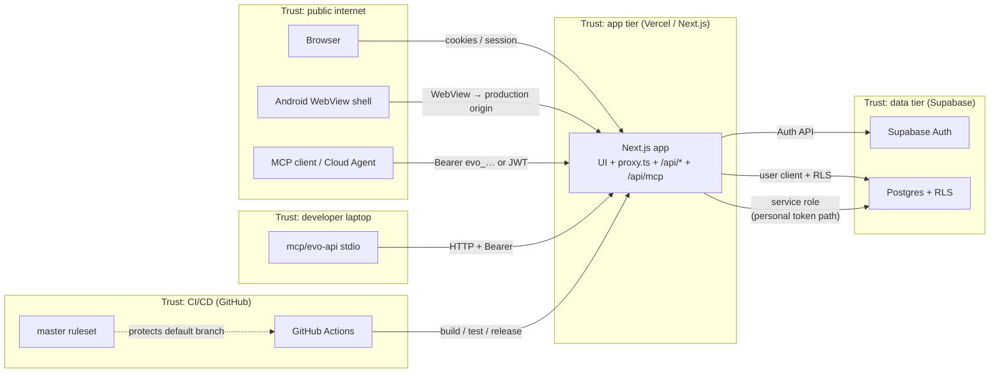

# EvoLift threat model (STRIDE)

Lightweight, maintainer-sized [STRIDE](https://www.practical-devsecops.com/what-is-stride-threat-model/) model for design-time review. Reporter-facing policy and control details stay in [`SECURITY.md`](../SECURITY.md). This file is the **living** decompose → categorize → mitigate map ([#266](https://github.com/matzekFloyd/EvoLift/issues/266)).

**Legend (STRIDE):** Spoofing · Tampering · Repudiation · Information disclosure · Denial of service · Elevation of privilege.

## Level-1 data flow

Trust boundaries are dashed boxes. Arrows are the main data/auth flows we care about at design time.

### Auth paths inside the app tier

| Path | Client used toward Postgres | RLS |
| --- | --- | --- |
| Browser / Android session | User Supabase client (session JWT) | **On** |
| Personal API token (`evo_…`) via `/api/*` or MCP | **Service-role** client | **Off** — every query must filter by `userId` / `requireOwned*` |
| MCP hosted tools | Same as above (reuses caller Bearer) | Same as above |

## Trust boundaries

| Boundary | Inside | Outside / peers |
| --- | --- | --- |
| **Public internet** | Untrusted browsers, agents, devices | Must authenticate before private data |
| **App tier** | Next.js on Vercel (`evo-lift/`) | Talks to Auth/DB with server secrets; never ships service role to clients |
| **Data tier** | Supabase Auth + Postgres | RLS is the last line for the JWT path; token path bypasses RLS by design |
| **CI/CD** | GitHub Actions + `master` ruleset | No Play/service-role secrets in workflows; SHA-pinned Actions |
| **MCP** | Hosted `/api/mcp` + laptop `mcp/evo-api` | Tools are HTTP API only; fail-closed `/api` paths; no direct Supabase from stdio |
| **Android shell** | Capacitor WebView | Loads production (or debug URL); not a separate backend |

## Threat table

Controls point at `SECURITY.md` sections or child issues. “Open/deferred” means accepted residual risk with a tracker.

| Element / interaction | S | T | R | I | D | E | Threat (short) | Control / status |
| --- | --- | --- | --- | --- | --- | --- | --- | --- |
| Browser ↔ Next (HTML) | ● | ● | · | ● | ● | ● | Session theft, XSS, clickjacking, unauthenticated UI | Cookie session + `getUser()` gate [#257](https://github.com/matzekFloyd/EvoLift/issues/257); CSP/headers [#255](https://github.com/matzekFloyd/EvoLift/issues/255); rate limits [#263](https://github.com/matzekFloyd/EvoLift/issues/263) |
| Browser ↔ Supabase Auth | ● | · | ● | ● | ● | · | Credential stuffing, weak passwords, verbose auth errors | Password policy [#261](https://github.com/matzekFloyd/EvoLift/issues/261); Auth rate limits; sanitized errors; MFA **deferred** [#297](https://github.com/matzekFloyd/EvoLift/issues/297) |
| Next ↔ DB (JWT + RLS) | ● | ● | · | ● | · | ● | Cross-user reads if RLS misconfigured | RLS on owner policies; migrations reviewed with schema changes |
| Next ↔ DB (personal token + service role) | ● | ● | · | ● | · | ● | **IDOR** if a handler omits `userId` filter | `requireOwned*` / ownership helpers [#256](https://github.com/matzekFloyd/EvoLift/issues/256); tokens hashed at rest |
| REST `/api/*` | ● | ● | ● | ● | ● | ● | Abuse, error leakage, unverified callers | Bearer auth; error hygiene [#258](https://github.com/matzekFloyd/EvoLift/issues/258); security events [#259](https://github.com/matzekFloyd/EvoLift/issues/259); rate limits [#263](https://github.com/matzekFloyd/EvoLift/issues/263) |
| MCP bridge | ● | ● | · | ● | ● | ● | Stolen token = full API; path/host escape; tool amplification | Threat notes + path allowlist + MCP rate budget [#265](https://github.com/matzekFloyd/EvoLift/issues/265); no cross-user tool args |
| CI/CD (Actions → deploy) | · | ● | · | ● | · | ● | Workflow tampering, over-privileged tokens, mutable Actions | SHA pins, least-privilege `permissions:`, `master` ruleset [#264](https://github.com/matzekFloyd/EvoLift/issues/264); Dependabot/audit [#260](https://github.com/matzekFloyd/EvoLift/issues/260) |
| Android shell | ● | ● | · | ● | · | · | WebView open redirects / wrong origin; keystore leakage | Origin allowlist; keystore gitignored ([Secrets](../SECURITY.md#secrets-and-environment)); not a second API |
| Secrets / env | · | ● | · | ● | · | ● | Service role or Play key in client or git | `NEXT_PUBLIC_*` allowlist only; server-only service role ([Secrets](../SECURITY.md#secrets-and-environment)) |
| Logging / monitoring | · | · | ● | ● | · | · | Logs hold secrets; no audit trail for auth abuse | Structured `channel":"security"` events; no passwords/tokens [#259](https://github.com/matzekFloyd/EvoLift/issues/259); alerting still minimal |

● = in scope for that STRIDE category on this element · = not the primary concern here (or covered elsewhere).

### Parent tracker

OWASP Top 10:2025 / STRIDE program umbrella: [#254](https://github.com/matzekFloyd/EvoLift/issues/254). Child hardening status table: [`SECURITY.md` → Related hardening work](../SECURITY.md#related-hardening-work).

## When to re-review

Re-open this doc (and update the DFD / table) when **any** of the following lands:

- [ ] **New auth path** — e.g. OAuth provider, MFA enrollment ([#297](https://github.com/matzekFloyd/EvoLift/issues/297)), magic link, or a second session store
- [ ] **New public API** — unauthenticated or broadly authenticated route under `/api/*`, or a new OpenAPI surface with different auth
- [ ] **New CI secret or deploy credential** — anything beyond `github.token`, or moving deploy into Actions (OIDC, cloud keys)
- [ ] **New MCP tool** — especially tools that take a user id, hit non-`/api` URLs, or talk to Supabase directly
- [ ] **Trust-boundary move** — e.g. native Android API, edge middleware with secrets, multi-tenant orgs, admin impersonation
- [ ] **RLS / service-role change** — new table without owner policy, or a new code path that uses the service-role client

After the review: update this file in the same PR as the architecture change; link the PR from the related SECURITY.md row if a new residual risk needs a tracker issue.

## Non-goals

- Commercial threat-modeling suites, full PASTA, or attack-tree libraries
- Replacing `SECURITY.md` as the vulnerability-reporting and control deep-dive
- Prompt-injection / agent product threat modeling beyond the HTTP/MCP tool bridge
